# PokopiaDex 詳細任務工單清單 (Detailed Tickets & Parallel Execution Plan)

> **追蹤狀態說明**：  
> ⚪ `Todo` 待認領 | 🟡 `In Progress` 開發 Subagent 執行中 | 🔵 `QA Review` QA Subagent 驗證中 | 🟢 `Done` 測試通過並合併

---

## ⚡ 平行處理架構 (Parallel Subagent Execution Waves)

```mermaid
flowchart LR
    subgraph Wave0["Wave 0: 基底環境 (Foundation)"]
        T1["TICK-001<br/>測試環境與專案清理"]
    end
    subgraph Wave1["Wave 1: 核心引擎平行開發 (4 Subagents Parallel)"]
        T2["TICK-002<br/>i18n 多語系與儲存引擎<br/>(js/i18n.js, js/storage.js)"]
        T3["TICK-003<br/>語音與三語連播引擎<br/>(js/speech.js)"]
        T4["TICK-004<br/>猜謎挑戰核心與修復<br/>(js/quiz-engine.js, quiz.html)"]
        T5["TICK-005<br/>徽章成就引擎與通知<br/>(js/badges-engine.js, badges.html)"]
    end
    subgraph Wave2["Wave 2: 頁面升級、PWA 與 Android 平行開發 (4 Subagents Parallel)"]
        T6["TICK-006<br/>三語同時對照模式<br/>(index.html, detail.html, settings.html)"]
        T7["TICK-007<br/>全站導覽列一致性與無障礙優化<br/>(All HTML navbars & a11y)"]
        T8["TICK-008<br/>PWA 離線快取與進度碼防護<br/>(sw.js, manifest.json)"]
        T9["TICK-009<br/>Android Capacitor 封裝與原生互動<br/>(capacitor.config.json, js/native.js, android/)"]
    end
    subgraph Wave3["Wave 3: 全域整合與 E2E 總驗收"]
        T10["TICK-010<br/>Playwright 全站 E2E 整合測試與 QA 總驗收"]
    end
    Wave0 --> Wave1 --> Wave2 --> Wave3
```

為了讓多個 Subagent 同時平行開發且互不衝突，我們使用 **Git Worktree 隔離技術**（每個 Subagent 在 `/home/antigravity/worktrees/<ticket-id>` 獨立分支中開發並執行 Vitest 單元測試），並將工單劃分為 3 個平行波次 (Waves)：

---

## Wave 0：基底測試環境與清理 (Foundation)

### [TICK-001] 建立測試環境 (Vitest + Playwright) 與清理專案歷史冗餘檔案
- **優先級**：P0 | **分支**：`feat/tick-001-test-infra` | **狀態**：🟢 Done
- **變更檔案**：
  - 新增：`package.json`, `vitest.config.js`, `playwright.config.js`
  - 修改：`.gitignore`
  - 刪除：`data/pokemon.json.bak`, `data/scrape.log`, `data/progress.json`, `data/scraped_raw.json`, `data/translation-batch-1.json`, `data/translation-batch-2.json`, `tunnel_new.pid`, `scripts/ngrok.zip`, `scripts/test-*.html`, `scripts/test-*.txt`, `scripts/full-page.html`, `scripts/full-combined.txt`
- **技術細節與規格**：
  1. 建立 `package.json`，設定 `"scripts"`:
     - `"test:unit": "vitest run"`
     - `"test:e2e": "playwright test"`
     - `"serve": "python3 -m http.server 8080"`
  2. 配置 `vitest.config.js` 使用 `jsdom` 環境，支援覆蓋率報告與全域 DOM API。
  3. 配置 `playwright.config.js` 自動啟動 `http://localhost:8080` webServer，並設定 Desktop Chrome 與 Mobile Pixel 7 視窗模擬。
  4. 清理上述高達 15MB+ 的爬蟲暫存檔與 `ngrok.zip`，保持儲存庫輕量。
- **測試與驗收標準 (QA Checklist)**：
  - [x] `npm run test:unit` 可正常執行並通過基礎 smoke test。
  - [x] 冗餘檔案已從 Git index 移除，`.gitignore` 包含 `node_modules/`, `coverage/`, `test-results/`, `playwright-report/`。

---

## Wave 1：核心業務引擎平行開發 (4 Subagents Parallel)

### [TICK-002] 多語系 (i18n) 集中管理與 Storage 資料持久化引擎
- **優先級**：P0 | **分支**：`feat/tick-002-i18n-storage` | **狀態**：🟢 Done
- **變更檔案**：
  - 新增：`js/i18n.js`, `js/storage.js`, `tests/unit/i18n.test.js`, `tests/unit/storage.test.js`
  - 修改：`app.js`
- **技術細節與規格**：
  1. **`js/i18n.js`**：
     - 統一收錄全站所有頁面的 `zh`、`en`、`es` 字典（包含 5 個底欄頁籤：`tab_dex`, `tab_habitats`, `tab_quiz`, `tab_badges`, `tab_settings`、18 種寶可夢屬性名稱、稀有度、時間、天氣、設定頁與徽章頁詞條）。
     - 提供 API：
       - `getLang()` / `setLang(lang)`（支援 `'zh' | 'en' | 'es'`，非法值自動 fallback 至 `'en'`，觸發 `CustomEvent('langchange')`）。
       - `t(key, lang)`：取得對應翻譯，若當前語系缺漏則 fallback 至 `en`，再無則回傳 `key`。
       - `applyI18nToDOM(root = document)`：自動綁定並更新所有 `[data-i18n]`、`[data-i18n-placeholder]`、`[data-i18n-title]` 元素。
  2. **`js/storage.js`**：
     - 統一封裝 `localStorage` 操作並具備 JSON parse 錯誤防護（防毀損崩潰）：
       - 收集狀態：`getCollectedIds()`, `isCollected(id)`, `setCollected(id)`, `setUncollected(id)`, `toggleCollected(id)`。
       - 三語模式：`isTrilingualMode()`, `setTrilingualMode(bool)`（Key: `'pokopia-trilingual'`）。
       - 語音設定：`getSpeechRate()`, `setSpeechRate(rate)`（支援 `0.8` 與 `1.0`，Key: `'pokopia-speech-rate'`）。
       - 統計紀錄：`getStats()`, `recordHabitatVisit(habitatId)`, `recordQuizResult({ score, maxCombo, total })`, `recordActiveHour(hour)`。
       - 進度碼編解碼：`encodeProgressCode()`, `decodeProgressCode(codeString)`（支援 `POKOPIA:v1:` 與 `POKOPIA:v2:` 向下相容格式，包含已收集寶可夢與統計資料）。
  3. 向下相容掛載至 `window.POKOPIA_I18N`、`window.POKOPIA_STORAGE` 與 `window.POKOPIA_DEX`，同時支援 CommonJS / ES Module 匯出供 Vitest 測試。
- **單元測試案例 (`tests/unit/i18n.test.js` & `tests/unit/storage.test.js`)**：
  - [x] 語系切換、非法語系 fallback、缺字回退、`applyI18nToDOM` DOM 更新（7/7 通過）。
  - [x] 收集 ID 新增/移除不重複、`localStorage` 髒資料容錯、進度碼 v1/v2 雙向編解碼與校驗錯誤處理（9/9 通過）。

---

### [TICK-003] 語音播放控制引擎與三語連續跟讀 (Speech & Karaoke Engine)
- **優先級**：P0 | **分支**：`feat/tick-003-speech-engine` | **狀態**：🟢 Done
- **變更檔案**：
  - 新增：`js/speech.js`, `tests/unit/speech.test.js`
- **技術細節與規格**：
  1. 封裝 `POKOPIA_SPEECH` 模組（支援瀏覽器全域與模組匯出）：
     - `getRate()` / `setRate(rate)`：讀取與設定播放倍速（`0.8` 慢速跟讀 / `1.0` 正常語速）。
     - `playKaraoke({ audioUrl, timingUrl, containerEl, fallbackText, lang, onWordHighlight, onEnd })`：
       - 優先載入 `audioUrl` (MP3) 並套用 `audio.playbackRate = getRate()`。
       - 若有 `timingUrl` (JSON)，依 `currentTime` 自動同步高亮對應單字/字元。
       - **離線/失敗自動降級 (Fallback)**：若 `fetch` 或 `Audio` 播放失敗，自動呼叫 `playWebSpeech(fallbackText, lang, getRate())` 使用瀏覽器 `window.speechSynthesis`（語系映射：`zh -> zh-TW`, `en -> en-US`, `es -> es-ES`）。
     - `playSequentialTrilingual({ id, type = 'pokemon', langs = ['zh', 'en', 'es'], onLangStart, onComplete })`：
       - 一鍵依序播放中 -> 英 -> 西三語名稱或簡介音檔，每段間隔 400ms，中途可呼叫 `stop()` 中斷。
     - `stop()`：立即停止正在播放的 HTML5 Audio 與 `speechSynthesis`。
- **單元測試案例 (`tests/unit/speech.test.js`)**：
  - [x] 倍速設定 `0.8x` / `1.0x` 正確套用至 Mock Audio 實例（12/12 通過）。
  - [x] 音檔載入失敗 (404 / Network Error) 時，100% 觸發 `speechSynthesis` Fallback 且語言代碼映射正確。
  - [x] `playSequentialTrilingual` 能依序走完 `zh -> en -> es` 並支援中途 `stop()` 中斷。

---

### [TICK-004] 猜謎挑戰模式 (Quiz) 重大 Bug 修復與 4 大題型 + Combo 完整實作
- **優先級**：P0 | **分支**：`feat/tick-004-quiz-mode` | **狀態**：🟢 Done
- **變更檔案**：
  - 新增：`js/quiz-engine.js`, `tests/unit/quiz-engine.test.js`
  - 修改：`scripts/quiz.js`, `quiz.html`
- **發現之現存 Bug（必須修復）**：
  1. `scripts/quiz.js` 目前讀取 `targetPoke.names` 與 `targetPoke.descriptions`，但 `data/pokemon.json` 實際欄位為單數 `name` 與 `description`，導致執行時直接 `TypeError` 崩潰。
  2. `startNewGame()` 將 `currentQuestionIndex` 設為 `0` 後呼叫 `nextQuestion()`，一進去就 `this.currentQuestionIndex++` 變成第 2 題，跳過第 1 題且總題數少 1 題。
  3. 圖片路徑應使用 `targetPoke.pokedex_number || targetPoke.id`。
  4. `quiz.html` 誤寫 `` 且缺乏頂部語言切換、題型/語言篩選設定與底部標準 5 頁籤導覽列。
- **技術細節與規格**：
  1. 建立純邏輯模組 `js/quiz-engine.js`（可獨立單元測試）：
     - 支援 5 種玩法模式選擇（`ALL` 綜合隨機、或單選 `A` 看圖猜名、`B` 看圖猜敘述、`C` 看名猜圖、`D` 看敘述猜名、`E` 聽音辨怪）。
     - 支援語言組合設定（題目語言：`zh / en / es / random`；選項語言：`zh / en / es / random`）。
     - 選項產生器：確保 3~4 個選項絕不重複，且正確答案包含在內。
     - Combo 與計分系統：
       - 基礎得分：答對 `+100` 分。
       - 連續答對 Combo 加成：`score += 100 + (combo - 1) * 25`（例如連對第 3 題得 150 分）。
       - 記錄最高連擊 `maxCombo`，回合結束時寫入 `localStorage` (`pokopia-quiz-stats`) 供徽章系統判定。
  2. 升級 `quiz.html` 與 `scripts/quiz.js`：
     - 統一使用 Pokopia 主題風格（Top Nav 語言切換 + 底部 5 個 Tab Bar）。
     - 顯示即時分數、當前 Combo 火焰特效 (`🔥 Combo x3`)、題目發音按鈕（點擊播放題目寶可夢語音）。
     - 結算畫面顯示總分、答對率、最高 Combo 與新解鎖徽章提示。
- **單元測試案例 (`tests/unit/quiz-engine.test.js`)**：
  - [x] 驗證模式 A / B / C / D / E 產生的題目結構完整，正確讀取 `pokemon.name[lang]` 與 `pokemon.description[lang]`（12/12 通過）。
  - [x] 驗證連續 10 題索引從 `1/10` 走到 `10/10` 不跳號，選項無重複。
  - [x] 驗證 Combo 加分與答錯歸零計算準確。

---

### [TICK-005] 徽章成就系統 (Badges) 12 項條件判定引擎、慶祝動效與頁面整合
- **優先級**：P1 | **分支**：`feat/tick-005-badges-engine` | **狀態**：🟢 Done
- **變更檔案**：
  - 新增：`js/badges-engine.js`, `tests/unit/badges-engine.test.js`
  - 修改：`badges.html`, `styles-badges.css`
- **發現之現存缺口**：
  - `badges.html` 字典定義了 12 個徽章（含 `type_specialist`, `habitat_hunter`, `night_owl`, `early_bird`），但 `BADGES` 陣列只寫了前 8 個數量徽章，後 4 個完全未實作，也增加不了猜謎徽章。
- **技術細節與規格**：
  1. 建立 `js/badges-engine.js`，完整定義並判定 **13 個成就徽章**：
     - 收集數量系列 (8 個)：`collector` (10), `explorer` (30), `veteran` (60), `master` (100), `legend` (150), `completionist` (200), `ultimate` (250), `god` (303)。
     - 特殊探索與學習系列 (5 個)：
       - `type_specialist` (🔥 屬性專家)：任一單一屬性收集滿 10 隻寶可夢。
       - `habitat_hunter` (🏝️ 棲息地獵人)：累計探索瀏覽過 50 個不同棲息地（或收集的寶可夢涵蓋 50 個不同棲息地，取較高者）。
       - `night_owl` (🦉 夜貓子)：在晚間 21:00 ~ 04:59 時段使用圖鑑。
       - `early_bird` (🐦 早起的鳥兒)：在早晨 05:00 ~ 08:59 時段使用圖鑑。
       - `quiz_master` (🎓 猜謎大師)：在猜謎挑戰達成單場 8 題以上正確或 5 連擊 (Combo >= 5)。
  2. 提供 API：
     - `evaluateAllBadges({ collectedIds, pokemonData, stats, currentHour })`：回傳所有徽章的 `{ id, unlocked, progress, current, target }` 清單。
     - `checkAndNotifyNewBadges()`：比對先前已解鎖紀錄 (`pokopia-unlocked-badges`)，若有新解鎖徽章，自動儲存並彈出可愛的慶祝 Toast 橫幅與 Web Audio 合成慶祝音效（免外部音檔依賴）。
  3. 更新 `badges.html` 渲染全部 13 個徽章、分類顯示進度條與解鎖狀態。
- **單元測試案例 (`tests/unit/badges-engine.test.js`)**：
  - [x] 測試 0, 10, 30, 303 隻收集數量的邊界條件（14/14 通過）。
  - [x] 測試同屬性滿 10 隻自動解鎖 `type_specialist`、不同屬性未滿 10 隻不解鎖。
  - [x] 測試時段判定 (`hour = 23` 解鎖 `night_owl`，`hour = 6` 解鎖 `early_bird`) 與 `quiz_master` 判定。
  - [x] 測試新徽章首次觸發通知、重複檢查不重複彈窗。

---

## Wave 2：頁面體驗升級、PWA 離線強化與 Android 原生封裝 (4 Subagents Parallel)

### [TICK-006] 三語同時對照模式 (Trilingual Simultaneous View) 與連續發音整合
- **優先級**：P1 | **分支**：`feat/tick-006-trilingual-view` | **狀態**：🟢 Done
- **變更檔案**：
  - 修改：`index.html`, `detail.html`, `styles.css`
  - 新增：`tests/unit/trilingual.test.js`
- **技術細節與規格**：
  1. **頂部快速開關**：
     - 在 `index.html` 與 `detail.html` 頂部導覽列新增「🌐 三語」快速切換膠囊按鈕 (`#trilingualBtn`)，一鍵開關三語並排模式 (`POKOPIA_DEX.setTrilingualMode`)。
  2. **首頁卡片 (`index.html`) 三語對照渲染**：
     - 開啟三語模式時，卡片以清晰的三語標籤並排顯示：`🇹🇼 妙蛙種子` · `🇺🇸 Bulbasaur` · `🇪🇸 Bulbasaur`，確保西班牙文長字串自動換行不溢出。
  3. **詳細頁 (`detail.html`) 三語對照與一鍵三語連播**：
     - 開啟三語模式時，「Pokopia 簡介 (Description)」與「理想棲息環境」同時並列顯示中、英、西三段對照文字。
     - 新增「🔊 三語連播 (Play All 3 Languages)」按鈕，呼叫 `POKOPIA_SPEECH.playSequentialTrilingual` 依序朗讀中、英、西名稱，並高亮當前朗讀的語言標籤。
     - 同時修正 `index.html` 與 `detail.html` 西班牙國旗為 `🇪🇸`，為 `detail.html` 補齊底部第 5 個 `quiz.html` 頁籤，並在收集寶可夢時呼叫 `POKOPIA_BADGES.checkAndNotifyNewBadges()`。
- **驗收測試**：
  - [x] 切換三語開關後，首頁卡片與詳細頁立即呈現三語並列區塊，且無橫向捲軸溢出（11/11 通過）。

---

### [TICK-007] 全站導覽列一致性、棲息地訪問紀錄與設定頁整合
- **優先級**：P1 | **分支**：`feat/tick-007-nav-consistency` | **狀態**：🟢 Done
- **變更檔案**：
  - 修改：`habitats.html`, `habitat-detail.html`, `settings.html`
  - 新增：`tests/unit/pages-integration.test.js`
- **技術細節與規格**：
  1. 為 `habitats.html`、`habitat-detail.html`、`settings.html` 補齊底部第 5 個頁籤「🎮 猜謎挑戰 (`quiz.html`)」，並統一載入 `js/i18n.js`、`js/storage.js`、`js/badges-engine.js`。
  2. `habitat-detail.html` 瀏覽棲息地時，自動呼叫 `POKOPIA_DEX.recordHabitatVisit(habitatId)` 與 `POKOPIA_BADGES.checkAndNotifyNewBadges()` 累計「棲息地獵人」徽章進度。
  3. `settings.html` 的 `#trilingualToggle` 與 `POKOPIA_DEX.isTrilingualMode()` / `setTrilingualMode()` 完整同步，並支援 v1/v2 進度碼產生與匯入（8/8 通過）。

---

### [TICK-008] PWA Service Worker 離線快取優化與跨裝置進度碼強化
- **優先級**：P2 | **分支**：`feat/tick-008-pwa-offline` | **狀態**：🟢 Done
- **變更檔案**：
  - 修改：`sw.js`, `manifest.json`
  - 新增：`tests/unit/sw-logic.test.js`
- **技術細節與規格**：
  1. 更新 `sw.js` 的 `APP_SHELL` 清單，納入 `quiz.html`、`scripts/quiz.js`、`scripts/qrcode.min.js` 及新增的 `js/*.js` 核心模組，確保離線時所有頁面皆能開啟。
  2. 新增 `AUDIO_CACHE = 'pokopia-audio-v1'`：
     - 針對 `/output/karaoke/` 與 `/output/habitat_karaoke/` 的音檔與 JSON 時間軸採 Cache-first + 數量上限控制（LRU 最多保留 150 個音檔，避免撐爆行動裝置容量）。
     - 離線且未快取時快速回傳 404 JSON，讓前端 `speech.js` 毫秒級無縫切換至 Web Speech API。
  3. 更新 `manifest.json` 的 `start_url` 為 `./index.html`（相對路徑相容 GitHub Pages 子路徑 `/pokopia-dex/` 與 Android Capacitor 本地協定）（8/8 通過）。

---

### [TICK-009] Android App (Capacitor) 專案建置與原生互動體驗整合
- **優先級**：P1 | **分支**：`feat/tick-009-android-app` | **狀態**：🟢 Done
- **變更檔案**：
  - 新增：`capacitor.config.json`, `js/native.js`, `scripts/build-web-dist.js`, `tests/unit/native.test.js`
  - 新增目錄：`android/` (Capacitor Android 原生工程結構與配置說明)
- **技術細節與規格**：
  1. 建立 `capacitor.config.json`：
     - `appId`: `"com.pokopia.dex"`
     - `appName`: `"PokopiaDex"`
     - `webDir`: `"dist"`
     - 配置 Android 全螢幕沉浸模式與混合內容許可。
  2. 建立輕量打包腳本 `scripts/build-web-dist.js` (`npm run build:web`)：
     - 將 HTML、CSS、`js/`、`scripts/`、`data/pokemon.json`、`data/habitat-data.js`、`assets/` 整理至 `dist/` 供 Capacitor 封裝。
  3. 建立 `js/native.js` (`POKOPIA_NATIVE`) 原生橋接層：
     - `hapticSuccess()` / `hapticLight()` / `hapticError()`：在 Android App / 支援 `navigator.vibrate` 的設備上提供震動回饋（收集寶可夢、猜謎答對、解鎖徽章時觸發），在桌面瀏覽器安全無感 fallback。
     - `setupBackButton()`：在 Android 原生環境監聽硬體返回鍵——若 Drawer 或 Modal 開啟則先關閉；若在內頁 (`detail.html`, `quiz.html` 等) 則返回 `index.html`；在首頁則提示再按一次退出。
     - `requestWakeLock()`：在播放卡拉 OK 語音或進行猜謎時透過 Screen Wake Lock API 防止兒童平板自動黑屏。
- **單元測試案例 (`tests/unit/native.test.js`)**：
  - [x] 驗證 Haptics 在有無 `navigator.vibrate` 環境下的安全執行（11/11 通過）。
  - [x] 驗證硬體返回鍵在不同頁面與 Modal 開啟狀態下的路由決策。
  - [x] 驗證 WakeLock 申請與釋放不拋出未捕捉異常。

---

## Wave 3：全站整合與 E2E 自動化總驗收

### [TICK-010] Playwright E2E 整合測試套件與 `qa-tester` 全站總驗收
- **優先級**：P0 | **分支**：`feat/tick-010-e2e-suite` | **狀態**：🟢 Done
- **變更檔案**：
  - 新增：`tests/e2e/pokedex.spec.js`, `tests/e2e/quiz-and-badges.spec.js`, `tests/e2e/settings-and-trilingual.spec.js`
  - 新增：`dev/TEST-REPORT.md`
- **E2E 整合測試涵蓋範圍**：
  1. **圖鑑與三語切換 (`pokedex.spec.js`)**：
     - 首頁載入 303 隻寶可夢卡片、搜尋過濾、屬性多選篩選。
     - 切換 `🇹🇼 / 🇺🇸 / 🇪🇸` 語系，驗證標題、搜尋框與卡片文字即時更新且無水平捲軸破版。
     - 點擊卡片收集圖示，驗證 `localStorage` 與視覺狀態同步。
  2. **猜謎挑戰與徽章解鎖 (`quiz-and-badges.spec.js`)**：
     - 進入 `quiz.html`，驗證第 1/10 題正常顯示寶可夢名稱/圖片（無 `undefined`）、點擊選項觸發回饋並推進至下一題。
     - 注入 10 隻同屬性寶可夢至 `localStorage`，造訪 `badges.html` 驗證「初級收藏家」與「屬性專家」徽章自動點亮為 Unlocked。
  3. **三語對照模式與進度碼同步 (`settings-and-trilingual.spec.js`)**：
     - 在 `settings.html` 開啟「三語同時顯示」，回到首頁與詳細頁驗證三語內容同時呈現。
     - 產生進度碼 (`POKOPIA:...`)，清除資料後再貼上進度碼還原，驗證收集進度 100% 恢復。
